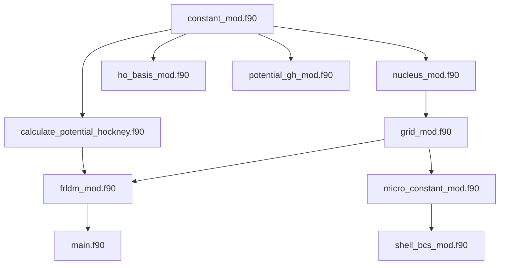
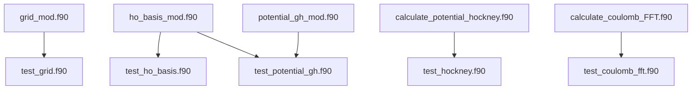
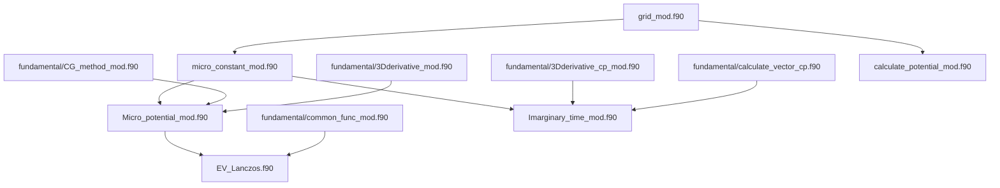

# MACROSCOPIC-MICROSCOPIC法

## 概要

このプロジェクトは、原子核物理学におけるFRLDM+Shell+BCSを解くためのプログラム群です．

## 参考文献

[Macro-Micro Frame Work](https://www.sciencedirect.com/science/article/pii/S0092640X1600005X)  
[Axial Asymmetry](https://iopscience.iop.org/article/10.1088/0031-8949/8/1-2/003)  
[Shell+Pairing](https://journals.aps.org/prc/abstract/10.1103/PhysRevC.5.1050)  
[Pairing](https://www.sciencedirect.com/science/article/pii/037594749290244E)  
[Shell1](https://www.sciencedirect.com/science/article/pii/0375947468906994)  
[Shell2](https://www.sciencedirect.com/science/article/pii/0375947467905106)  
[Nilsson Oscillator](https://www.sciencedirect.com/science/article/pii/0375947469908094)


## 各ファイルの依存関係
A --> B は「B が A を use している」ことを表します（各ファイルの `use` 文から作成）．間接的に参照しているものは省略しています（例：constant_mod.f90 はほぼすべてのファイルが use しています）．

### FRLDM+Shell+BCS で使うファイル



- FRLDM：constant_mod → nucleus_mod → grid_mod → frldm_mod（B_1, B_3 は calculate_potential_hockney）→ main
- Shell+BCS：ho_basis_mod（三軸変形 HO 基底）と potential_gh_mod（求積点上の V1, ∇V1, VC）で一粒子準位を求め，shell_bcs_mod でシェル補正と BCS を計算する予定です．ho_basis_mod と potential_gh_mod は互いに use していません（test_potential_gh.f90 で組み合わせています）．shell_bcs_mod はまだ中身がなく，main からも呼ばれていません．
- frldm_mod と main は `use CG_method_mod` が残っていますが，CG のルーチンはもう呼んでいません．

### テストプログラム



### 旧方式（格子 + Lanczos / 虚時間）のファイル



calculate_coulomb_FFT.f90（FALR 法）と fundamental/FFT_integral_mod.f90 はどこからも use されていません．

## 三軸変形調和振動子基底 (ho_basis_mod.f90)

三軸変形核の一粒子準位を変形調和振動子基底の行列対角化で求めるモジュールです．ポテンシャル・∇V₁はGauss–Hermite求積点 `basis%point(axis,i)` 上で与えます．LAPACK (dstev, zheev) が必要です．

```bash
gfortran -O2 -fopenmp constant_mod.f90 ho_basis_mod.f90 test_ho_basis.f90 -llapack -o test_ho_basis.exe
./test_ho_basis.exe
```

## 求積点上のポテンシャル (potential_gh_mod.f90)

折りたたみ湯川ポテンシャル V₁，その勾配 ∇V₁，クーロンポテンシャル V_C を，生成形状の表面積分で任意の点（Gauss–Hermite求積点など）上に計算するモジュールです（FRDM2012 式(81),(91)）．ポアソン方程式を解かないので，無限遠の境界条件は厳密に満たされます．

- `Y = V₁/(-V₀)`，`∇Y`，`C = V_C/(e²ρ_c)` を返します．`V₁ = -V₀ Y`，`V_C = e²ρ_c C`（ρ_c = Z/(4πR_pot³/3)）です．
- 形状は `surface_shape` を拡張して追加します．今は三軸楕円体 `ellipsoid_shape` と，(ε, γ) から作る `ellipsoid_from_eps_gamma` があります．
- 表面近くの点は，表面パネルを適応的に分割して計算します．∇Y の 1/s 特異性は恒等式で取り除いてあります．
- `on_grid(..., d2h=.true.)` で鏡映対称性を使い，1/8 の点だけを計算します．

```bash
gfortran -O2 -fopenmp constant_mod.f90 ho_basis_mod.f90 potential_gh_mod.f90 test_potential_gh.f90 -llapack -o test_potential_gh.exe
./test_potential_gh.exe
```

既知の制限：∇V₁ は表面で折れ曲がる（2階微分が不連続な）ため，スピン軌道項の行列要素の Gauss–Hermite 求積の収束が遅く，球形核でも (2j+1) 重縮退が数十 keV ほど分裂します（²⁰⁸Pb で最大 0.04 MeV）．部分積分で ∇V₁ の代わりに V₁ を使う形にすると改善できる見込みです．

## 空間格子 (grid_mod.f90)

格子の範囲は変形パラメータ (ε, γ) から決めます．`nucleus%epsilon2`（ε）と `nucleus%gamma_deg`（γ，度）を設定してから `initialize_grid` を呼びます．

- 半軸 R_x, R_y, R_z は `semi_axes_from_eps_gamma` で求めます．振動数 ω_i に反比例し，R_x R_y R_z = R_a³（体積保存）です．ho_basis_mod，potential_gh_mod と同じ規約です．
- γ = 0 は z 軸まわりの軸対称（ε > 0 で長楕円），γ = 60° は x 軸まわりの扁平形です．
- 内外判定は三軸楕円体 (x/R_x)² + (y/R_y)² + (z/R_z)² ≤ 1 で行います．
- `grid%cubic = .true.`（既定）では，一番長い半軸に合わせた立方体の箱にします．CG_method_mod が n_x = n_y = n_z を仮定しているためです．`.false.` にすると軸ごとに箱の大きさを決めます．

```bash
gfortran -O2 -fopenmp constant_mod.f90 nucleus_mod.f90 grid_mod.f90 test_grid.f90 -o test_grid.exe
./test_grid.exe
```

## クーロンポテンシャル (calculate_coulomb_FFT.f90)

クーロンポテンシャル V(r) = ∫ρ(r′)/|r − r′| d³r′ を，Lauritsch–Reinhard の FALR 法（thesis/FFTcoulomb.pdf）で計算します．箱の境界でディリクレ条件を課す CG_method_poisson3D の代わりに，無限遠で V → 0 という正しい境界条件になります．

1. 多重極モーメント q_lm（l ≤ 4）を求め，同じモーメントをもつ ρ_long = Σ a_lm ρ_l(r) S_lm を作ります．
2. V_long は l ごとの動径方程式をグリーン関数で解きます．
3. 残りの ρ_short = ρ − ρ_long は多重極をもたないので，FFT（V = 4πρ̃/k²）で解いても周期像の影響がほとんど残りません．k = 0 成分は −(2π/3)∫r²ρ_short で決めます．

論文は l_cut = 2 ですが，変形核は十六重極モーメントが大きいので l_cut = 4 にしています．呼び方は `call calculate_coulomb(rho, R, h, V)` です（R は参照密度の半径で，`nucleus%R_a` を渡します）．FFTW3 が必要です（Ubuntu は `sudo apt install libfftw3-dev`，Windows は MSYS2 の `pacman -S mingw-w64-x86_64-fftw`）．

```bash
gfortran -O2 -fopenmp -I/usr/include constant_mod.f90 calculate_coulomb_FFT.f90 test_coulomb_fft.f90 -lfftw3 -o test_coulomb_fft.exe
./test_coulomb_fft.exe
```

## 自由空間の畳み込み (calculate_potential_hockney.f90)

Hockney 法で，クーロン ∫ρ/|r−r′|，湯川 ∫ρ e^{−|r−r′|/a}/|r−r′|，指数 ∫ρ e^{−|r−r′|/a} の 3 種類のポテンシャルを計算します．frldm_mod の B_1, B_3 はこれを使います．

- 格子を各軸 2 倍の箱に入れて残りを 0 で埋め，FFT で巡回畳み込みをとります．元の格子の 2 点間の距離は 2 倍の箱の半分を超えないので，自由空間の和と厳密に一致します．箱の境界条件は不要です．
- 核は各セルでの平均値を使います（自己セルは 1/r の立方体積分 2.3800773…/h）．このため，セルごとに一定の密度（grid_mod の内外判定 `density_index3D`）に対しては厳密です．滑らかな密度を点の値で渡すときは `smooth = .true.` にします．
- B_1 の核 (2a/r − 1)e^{−r/a} と B_3 の核 1/r − (1/r + 1/(2a))e^{−r/a} を同じ方法で畳み込むので，以前の O(N²) の二重和が不要になりました．
- メモリは格子の 8 倍です．FFTW3 が必要です．

```bash
gfortran -O2 -fopenmp -I/usr/include constant_mod.f90 calculate_potential_hockney.f90 test_hockney.f90 -lfftw3 -o test_hockney.exe
./test_hockney.exe
```

## 運用

1. [プロジェクトのフォークを作成]
2. [変更を加える]
3. [プルリクエストを送信]


## 更新履歴

* 2026/4/21: [README.md を作成]
* 2026/5/14: [依存関係を明記]
