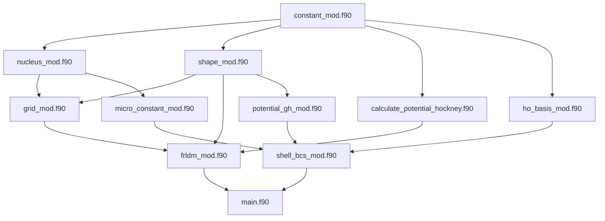
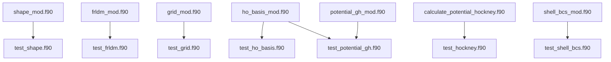

# MACROSCOPIC-MICROSCOPIC法

## 概要

このプロジェクトは、原子核物理学におけるFRLDM+Shell+BCSを解くためのプログラム群です．

## オブジェクト指向プログラミングに慣れていない人向け

このコードは Fortran のオブジェクト指向の書き方（派生型，型束縛手続き `call frldm%calculate_frldm_energy(...)` など）を使っています．慣れていない人は，先に解説書を読んでください．

- [Fortran で学ぶオブジェクト指向プログラミング（PDF）](docs/fortran_oop_guide.pdf)

モジュールとカプセル化，派生型と型束縛手続き，継承，多態性（`class`，`select type`），抽象型と `deferred`，演算子の多重定義を，すぐに動かせる短い例で説明しています．液滴模型項・殻補正・対相関を抽象型で部品化する例（簡略化したトイモデル）や，複数ファイルのコンパイル順，よくある落とし穴もまとめています．

## 使い方 (main.f90)

main は 1 つの原子核について，FRLDM の巨視的エネルギーと，Strutinsky 法のシェル補正 + Lipkin–Nogami（または BCS）の対補正を計算し，質量超過と結合エネルギーを出力します．

- M_th = E_mac + E_shell + E_pair（質量超過，MeV）
- B = Z M_H + N M_n − M_th（結合エネルギー）
- 形は FRDM の ε パラメータ (ε2, γ, ε4, ε6) です．
- `search = .true.` にすると (ε2, ε4) の格子上で E_mac + E_s+p が最小になる形を探し，その形で結果を出します．
- 零点エネルギー（FRDM2012 Sec. 2.11）はまだ入れていません．

```bash
bash build.sh        # FFTW3 と LAPACK が必要
./main.exe input.nml # input.nml がなければ 208Pb（球形）で計算します
./main.exe input_240Pu.nml
```

入力は namelist `&frldm_input` です（例：²⁴⁰Pu を FRDM2012 の基底状態の形で計算）．

```
&frldm_input
  Z = 94, N = 146,
  eps2 = 0.22, gamma_deg = 0.0, eps4 = -0.05, eps6 = 0.04,
  pairing = 'LN',          ! 'LN'（既定，FRDM2012）または 'BCS'
  n_gh = 44,               ! 一粒子問題の Gauss-Hermite 点数（各軸）
  use_grid = .false.,      ! .true. で B_1, B_3 を格子 + Hockney 法で計算（検算用）
  h = 0.5, n_times = 3,    ! そのときの格子間隔 [fm] と箱の大きさ
  search = .false.,        ! 基底状態の探索
  eps2_min = 0.0, eps2_max = 0.30, d_eps2 = 0.05,
  eps4_min = -0.08, eps4_max = 0.08, d_eps4 = 0.04
/
```

計算時間は 1 つの形あたり約 10 秒です（4 スレッド，ほとんどが一粒子問題）．

### FRDM2012 との比較

FRDM2012 の表の値と比べました（E_mac の表の値は M_th^FL − E_mic^FL）．

| 核 | 形 (ε2, ε4, ε6) | E_mac 本コード | E_mac 表 | E_s+p 本コード | E_s+p 表 |
|---|---|---|---|---|---|
| ²⁰⁸Pb | (0, 0, 0) | −8.70 | −8.72 | −13.94 | −13.93 |
| ¹³²Sn | (0, 0, 0) | −64.97 | −64.98 | −12.83 | −12.82 |
| ²⁴⁰Pu | (0.22, −0.05, 0.04) | — | — | −4.93 | −4.95 |
| ⁴⁰Ca | (0, 0, 0) | −37.51 | −37.52 | −0.52 | −0.52 |
| ⁴⁸Ca | (0, 0, 0) | −43.34 | −43.34 | −1.95 | −1.94 |

²⁴⁰Pu は表の E_mac が球形の値なので比べていません．M_th は表の M_th^FL より 1〜2 MeV 低く出ます（²⁰⁸Pb で −22.64 と −21.31）．差はほぼ零点エネルギーで，E_mic^FL − E_s+p（²⁰⁸Pb で 1.34 MeV）と一致します．

## 参考文献

[Macro-Micro Frame Work](https://www.sciencedirect.com/science/article/pii/S0092640X1600005X)  
[Axial Asymmetry](https://iopscience.iop.org/article/10.1088/0031-8949/8/1-2/003)  
[Shell+Pairing](https://journals.aps.org/prc/abstract/10.1103/PhysRevC.5.1050)  
[Pairing](https://www.sciencedirect.com/science/article/pii/037594749290244E)  
[Shell1](https://www.sciencedirect.com/science/article/pii/0375947468906994)  
[Shell2](https://www.sciencedirect.com/science/article/pii/0375947467905106)  
[Nilsson Oscillator](https://www.sciencedirect.com/science/article/pii/0375947469908094)


## 各ファイルの依存関係
A --> B は「B が A を use している」ことを表します（各ファイルの `use` 文から作成）．間接的に参照しているものは省略しています（例：constant_mod.f90 はほぼすべてのファイルが use しています）．

### FRLDM+Shell+BCS で使うファイル



- 形状：shape_mod（FRDM の ε パラメータの形）を FRLDM と一粒子ポテンシャルの両方で使います．
- FRLDM：frldm_mod が B_1, B_3 を形の表面積分で計算します（`use_grid` のときは grid_mod + calculate_potential_hockney）．
- Shell+pairing：ho_basis_mod（三軸変形 HO 基底）と potential_gh_mod（求積点上の V1, VC）で一粒子準位を求め，shell_bcs_mod でシェル補正と対補正を計算します．
- main が両方を呼んで合計します．

### テストプログラム



### 使わないファイル (not_use/)

FRLDM+Shell+BCS の計算に使わないファイルは not_use/ にまとめています（ビルドには含めません）．

- 旧方式（格子 + Lanczos / 虚時間）：Micro_potential_mod.f90，EV_Lanczos.f90，Imarginary_time_mod.f90，calculate_potential_mod.f90，fundamental/（CG_method_mod.f90，3Dderivative_mod.f90，3Dderivative_cp_mod.f90，calculate_vector_cp.f90，common_func_mod.f90，FFT_integral_mod.f90）
- FALR 法のクーロン計算：calculate_coulomb_FFT.f90，test_coulomb_fft.f90（Hockney 法に置き換えました）
- その他：io_mod.f90（空），data.text（以前の出力）

## 原子核の形 (shape_mod.f90)

FRDM2012 の ε パラメータ (ε2, γ, ε4, ε6)（Eqs. (17)–(25)）の形を，伸縮座標での Nilsson 等ポテンシャル面として作ります．

- `epsilon_shape_from(R, eps2, gamma, eps4, eps6)`（γ はラジアン）で，体積 4πR³/3 の形を返します．
- `eval(u, v, r, N)` で表面の点と法線 N = ∂r/∂u × ∂r/∂v，`inside(x)` で内外判定，`relative_area()` で B_s（Eq. 70），`volume()` で体積を返します．
- ε4 = ε6 = 0 では `ellipsoid_from_eps_gamma` の楕円体と一致します．²⁴⁰Pu（ε2 = 0.22, ε4 = −0.05, ε6 = 0.04）の β2, β4, β6 = 0.237, 0.086, −0.024 は FRDM2012 の表と一致します．

```bash
gfortran -O2 constant_mod.f90 shape_mod.f90 test_shape.f90 -o test_shape.exe
./test_shape.exe
```

## FRLDM (frldm_mod.f90)

`call frldm%calculate_frldm_energy(nucleus, shape, E_mac)` で FRDM2012 の Eq. (62) を計算します．E_mac は質量超過としての値で，M_H Z + M_n N を含みます．各項は `frldm%E_v`，`frldm%E_s` などに入ります．

- B_1, B_3 は二重体積積分を Gauss の定理で二重表面積分 −∮∮(dS·dS′) g(|r−r′|) に直して計算します（∇²g が元の核）．B_1 は g = −a² e^{−σ/a}，B_3 は g = a[s/2 − e^{−s}/2 + 2(1 − e^{−s})/s]（s = σ/a）です．
- B_3 の被積分関数は滑らかで，球で 1e−10 の精度です．B_1 は σ = 0 の折れ目のため誤差が n^{−3} で減るので，n と 3n/2 の 2 点から Richardson 外挿します（球で 3e−5）．1 回の計算は約 2 秒です．
- 格子 + Hockney 法（`g_mod` を渡したとき）も残してあります．表面のセルを体積比で扱うので B_3 は格子間隔 0.4 fm で 1e−3 まで合いますが，B_1 は表面がぼやける分だけ O(h) 小さく出ます（¹⁶O，h = 0.5 fm で 5%）．
- B_W = 1（基底状態の一体形状）としています．

```bash
gfortran -O2 -fopenmp -I/usr/include constant_mod.f90 nucleus_mod.f90 shape_mod.f90 grid_mod.f90 calculate_potential_hockney.f90 frldm_mod.f90 test_frldm.f90 -lfftw3 -o test_frldm.exe
./test_frldm.exe
```

## 三軸変形調和振動子基底 (ho_basis_mod.f90)

三軸変形核の一粒子準位を変形調和振動子基底の行列対角化で求めるモジュールです．ポテンシャル・∇V₁はGauss–Hermite求積点 `basis%point(axis,i)` 上で与えます．LAPACK (dstev, zheev) が必要です．

```bash
gfortran -O2 -fopenmp constant_mod.f90 ho_basis_mod.f90 test_ho_basis.f90 -llapack -o test_ho_basis.exe
./test_ho_basis.exe
```

## 求積点上のポテンシャル (potential_gh_mod.f90)

折りたたみ湯川ポテンシャル V₁，その勾配 ∇V₁，クーロンポテンシャル V_C を，生成形状の表面積分で任意の点（Gauss–Hermite求積点など）上に計算するモジュールです（FRDM2012 式(81),(91)）．ポアソン方程式を解かないので，無限遠の境界条件は厳密に満たされます．

- `Y = V₁/(-V₀)`，`∇Y`，`C = V_C/(e²ρ_c)` を返します．`V₁ = -V₀ Y`，`V_C = e²ρ_c C`（ρ_c = Z/(4πR_pot³/3)）です．
- 形状は shape_mod の `surface_shape` を使います（`epsilon_shape`，`ellipsoid_shape`）．
- 表面近くの点は，表面パネルを適応的に分割して計算します．∇Y の 1/s 特異性は恒等式で取り除いてあります．
- `on_grid(..., d2h=.true.)` で鏡映対称性を使い，1/8 の点だけを計算します．

```bash
gfortran -O2 -fopenmp constant_mod.f90 shape_mod.f90 ho_basis_mod.f90 potential_gh_mod.f90 test_potential_gh.f90 -llapack -o test_potential_gh.exe
./test_potential_gh.exe
```

スピン軌道項：∇V₁ は表面で折れ曲がるため，⟨(∂_jV₁)∂_k⟩ の形のままでは Gauss–Hermite 求積が収束せず，球形核でも (2j+1) 重縮退が最大 0.04 MeV 分裂していました．部分積分した A_jk = −∫V₁(∂_jφ_a ∂_kφ_b − ∂_kφ_a ∂_jφ_b) を使う `spin_orbit_matrices_by_parts` に変えたので，分裂は求積点の数とともに小さくなります（²⁰⁸Pb で n_gh = 44 のとき 0.01 MeV 以下，56 のとき 0.003 MeV 以下）．

## 空間格子 (grid_mod.f90)

格子の範囲は変形パラメータから決めます．`nucleus%epsilon2`，`nucleus%gamma_deg`（度），`nucleus%epsilon4`，`nucleus%epsilon6` を設定してから `initialize_grid` を呼びます．格子は main の `use_grid = .true.` のとき（B_1, B_3 の検算）だけ使います．

- 形は shape_mod の `epsilon_shape` で，`grid%shape` に入ります．`grid%semi` はその各軸方向の広がりです．
- γ = 0 は z 軸まわりの軸対称（ε > 0 で長楕円），γ = 60° は x 軸まわりの扁平形です．
- 内外判定は形の `inside` で行います．表面にかかるセルは n_sub³（既定 6³）点のうち内側の割合を値にするので，体積の誤差は 1e−4 程度です．
- `grid%cubic = .true.`（既定）では，一番長い半軸に合わせた立方体の箱にします．以前の CG_method_mod が n_x = n_y = n_z を仮定していたためです（Hockney 法は直方体の箱でも計算できます）．`.false.` にすると軸ごとに箱の大きさを決めます．

```bash
gfortran -O2 -fopenmp constant_mod.f90 nucleus_mod.f90 shape_mod.f90 grid_mod.f90 test_grid.f90 -o test_grid.exe
./test_grid.exe
```

## クーロンポテンシャル (not_use/calculate_coulomb_FFT.f90，現在は未使用)

クーロンポテンシャル V(r) = ∫ρ(r′)/|r − r′| d³r′ を，Lauritsch–Reinhard の FALR 法（thesis/FFTcoulomb.pdf）で計算します．箱の境界でディリクレ条件を課す CG_method_poisson3D の代わりに，無限遠で V → 0 という正しい境界条件になります．

1. 多重極モーメント q_lm（l ≤ 4）を求め，同じモーメントをもつ ρ_long = Σ a_lm ρ_l(r) S_lm を作ります．
2. V_long は l ごとの動径方程式をグリーン関数で解きます．
3. 残りの ρ_short = ρ − ρ_long は多重極をもたないので，FFT（V = 4πρ̃/k²）で解いても周期像の影響がほとんど残りません．k = 0 成分は −(2π/3)∫r²ρ_short で決めます．

論文は l_cut = 2 ですが，変形核は十六重極モーメントが大きいので l_cut = 4 にしています．呼び方は `call calculate_coulomb(rho, R, h, V)` です（R は参照密度の半径で，`nucleus%R_a` を渡します）．FFTW3 が必要です（Ubuntu は `sudo apt install libfftw3-dev`，Windows は MSYS2 の `pacman -S mingw-w64-x86_64-fftw`）．

```bash
gfortran -O2 -fopenmp -I/usr/include constant_mod.f90 not_use/calculate_coulomb_FFT.f90 not_use/test_coulomb_fft.f90 -lfftw3 -o test_coulomb_fft.exe
./test_coulomb_fft.exe
```

## 自由空間の畳み込み (calculate_potential_hockney.f90)

Hockney 法で，クーロン ∫ρ/|r−r′|，湯川 ∫ρ e^{−|r−r′|/a}/|r−r′|，指数 ∫ρ e^{−|r−r′|/a} の 3 種類のポテンシャルを計算します．frldm_mod の格子版の B_1, B_3（`use_grid`）はこれを使います．

- 格子を各軸 2 倍の箱に入れて残りを 0 で埋め，FFT で巡回畳み込みをとります．元の格子の 2 点間の距離は 2 倍の箱の半分を超えないので，自由空間の和と厳密に一致します．箱の境界条件は不要です．
- 核は各セルでの平均値を使います（自己セルは 1/r の立方体積分 2.3800773…/h）．このため，セルごとに一定の密度（grid_mod の内外判定 `density_index3D`）に対しては厳密です．滑らかな密度を点の値で渡すときは `smooth = .true.` にします．
- B_1 の核 (2a/r − 1)e^{−r/a} と B_3 の核 1/r − (1/r + 1/(2a))e^{−r/a} を同じ方法で畳み込むので，以前の O(N²) の二重和が不要になりました．
- メモリは格子の 8 倍です．FFTW3 が必要です．

```bash
gfortran -O2 -fopenmp -I/usr/include constant_mod.f90 calculate_potential_hockney.f90 test_hockney.f90 -lfftw3 -o test_hockney.exe
./test_hockney.exe
```

## シェル補正と対補正 (shell_bcs_mod.f90)

`call shell_bcs_calculation(nucleus, mv, res, n_gh, pairing)` で，(ε2, γ, ε4, ε6) の形について中性子・陽子のシェル補正と対補正を計算します（FRDM2012 Eqs. (78)–(111)，Möller–Nix 1992）．定数は micro_constant_mod のものを使います．

1. 一粒子準位：ho_basis_mod の変形 HO 基底（ħω0 = C_cur/A^{1/3}，N_bas = 12 殻）と potential_gh_mod の V1, VC（半径 R_pot の ε 形状）からハミルトニアンを作り，対角化します．スピン軌道項は部分積分形です．δ̄, ε̄, R_pot, V_p, V_n などは `mv%calculate_microscopic_variables`（Eqs. (82)–(93)）で `mv` に入ります．
2. Strutinsky 法：ガウス関数 × p 次の補正多項式（p = 8）で平滑化します．幅は γ_S = C_S ħω0 B_s です．E_shell = Σe_i − Ẽ．
3. 対補正（既定は Lipkin–Nogami，`pairing = 'BCS'` で BCS）：有効相互作用ギャップ Δ_G = r_mic B_s / N^{1/3} と平滑化した準位密度から G を決めます（Eq. 107）．
   - Lipkin–Nogami（Eqs. (94)–(101)）：λ2 についての 1 つの方程式にまとめ，二分法で解きます（内側でずらした準位 ε_k = e_k + (4λ2 − G)v_k² の BCS 方程式を解きます）．Δ → 0 で λ2 が発散するので，魔法数でも解がつぶれません．平均値は Eqs. (108)–(110) です．
   - BCS：Möller–Nix Eqs. (5), (27)．魔法数など解がないときは Δ = 0 とします．
   - 対の窓は「最後の束縛準位」か「フェルミ準位から 5 MeV 上」の高い方まで，下にも同じ数の準位をとります．奇数粒子は blocking せず，準粒子エネルギーを加えます．平均の奇数項は FRLDM と同じ Δ̄ = r_mac B_s / N^{1/3}（Eqs. (63), (64)）です．
   - r_mic = 3.2 MeV は Lipkin–Nogami 用の値です．BCS で使う場合は合わせ直す必要があります．

```bash
gfortran -O2 -fopenmp constant_mod.f90 nucleus_mod.f90 shape_mod.f90 micro_constant_mod.f90 ho_basis_mod.f90 potential_gh_mod.f90 shell_bcs_mod.f90 test_shell_bcs.f90 -llapack -o test_shell_bcs.exe
./test_shell_bcs.exe
```

## 残っていること

- 零点エネルギー（FRDM2012 Sec. 2.11）：ε2 と γ 方向のポテンシャルの曲率と慣性から求める項で，まだ入れていません．M_th が表の値より 1〜2 MeV 低いのはこのためです．
- 基底状態の探索は (ε2, ε4) の格子探索だけです．ε3, ε6, γ を含む探索や最小値の補間はしていません．
- D2h 対称性によるハミルトニアンのブロック対角化（ho_basis_mod の TODO）．速くなりますが結果は変わりません．

## 運用

1. [プロジェクトのフォークを作成]
2. [変更を加える]
3. [プルリクエストを送信]


## 更新履歴

* 2026/4/21: [README.md を作成]
* 2026/5/14: [依存関係を明記]
* 2026/10/12: [main を FRLDM+Shell+LN に対応，ε4, ε6 の形，B_1, B_3 の表面積分，Lipkin–Nogami，スピン軌道項の部分積分]
* 2026/10/15: [Fortran のオブジェクト指向プログラミングの解説書 (docs/fortran_oop_guide.pdf) を追加]
